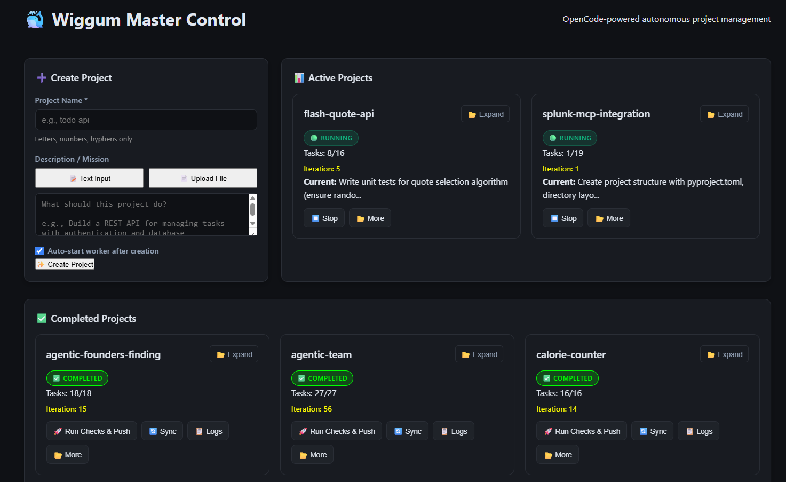

# WiggumLoop

An autonomous coding loop. You give it a task list, and an AI agent works through it one task at a time: write the code, run the tests, commit, push, repeat. Each project gets its own GitHub repo, and several projects can run in parallel.

It runs on [OpenCode](https://opencode.ai) with free models from [OpenRouter](https://openrouter.ai), so a full run can cost nothing.



## How it works

1. You describe a project. WiggumLoop creates a folder, a GitHub repo and a `TASKS.md` checklist.
2. A worker picks the first unchecked task and hands it to the coding agent.
3. The agent writes code and tests, then commits and pushes.
4. A judge scores the iteration (see below), and the worker moves to the next task.

## Quick start

Requires Linux, Node.js, Python 3, the [GitHub CLI](https://cli.github.com) (logged in) and an OpenRouter API key.

```bash
npm install -g opencode-ai

cp .env.example .env        # then add your OPENROUTER_API_KEY and pick a WIGGUM_MODEL

bash wiggum_master.sh create "todo-api" "A FastAPI REST API with SQLite and CRUD endpoints"
```

`create` sets up `projects/todo-api/`, generates a task list and starts a worker. Edit `projects/todo-api/TASKS.md` if you want more specific tasks. Small, testable tasks work best.

```bash
bash wiggum_master.sh status todo-api    # progress
bash wiggum_master.sh stop todo-api      # stop the worker
```

Two paths are still hardcoded to the author's machine. See [Setup notes](DOCUMENTATION.md#setup-notes) before your first run.

## The Jev judge

After every iteration, a small decision model ([Jev](https://openrouter.ai/docs/guides/community/jev)) answers four questions about the diff and logs a probability for each:

| Question | What it catches |
|---|---|
| `done` | Is the task fully completed? |
| `progress` | Did this iteration move the task forward? |
| `cheated` | Did it weaken tests or checks to make things pass? |
| `out_of_scope` | Did it change things the task did not ask for? |

The judge only observes for now. It does not stop or change the loop. Each verdict costs about $0.0001.

On a 12-case labelled test, Jev caught all 4 cheating iterations where `gpt-4o-mini` caught 2 ([eval/RESULTS.md](eval/RESULTS.md)). That is a smoke test, not a benchmark.

## Example run

[csv2md-wiggum](https://github.com/Julien-ser/csv2md-wiggum) was built by the loop with no human in it: a CSV-to-Markdown command-line tool, 8 tasks, 37 iterations, 32 passing tests, on a free model. The judge's verdicts are in that repo under `logs/jev-decisions.jsonl`.

## Documentation

- [DOCUMENTATION.md](DOCUMENTATION.md): architecture, commands, agent roles, the judge, configuration, troubleshooting
- [GETTING_STARTED.md](GETTING_STARTED.md): longer walkthrough
- [AGENT_ROLES.md](AGENT_ROLES.md): the specialist roles a worker can take
- [GITHUB_WORKFLOWS.md](GITHUB_WORKFLOWS.md) and [CI_ERROR_REPORTING.md](CI_ERROR_REPORTING.md): CI setup and how failures feed back into the loop
- [VOICE_SERVER.md](VOICE_SERVER.md): optional dashboard and voice control

## License

MIT
